# OpenMusic 设计文档 —— 数据模型

数据库：PostgreSQL 17。主键统一 `bigint GENERATED ALWAYS AS IDENTITY`（对 Subsonic 层以字符串形式暴露）。时间戳统一 `timestamptz`（UTC）。

迁移：`@effect/sql` Migrator，`apps/server/src/db/migrations/NN-name.sql`，只增不改历史文件。

`0011-track-metadata-overrides.sql`：`track_metadata_overrides(track_id, fields)` 只存调用方明确提供的标题、曲目/专辑艺人、专辑、流派、曲号和碟号。部分编辑按字段合并，不存自动推断、封面字节或媒体属性。同视频、同名曲、同一专辑下的其他文件版本不继承；删除该物理曲目时级联删除覆盖值。迁移不从旧标签猜测覆盖值，不触发扫描。

## 1. ER 图

```mermaid
erDiagram
    users ||--o{ sessions : ""
    users ||--o{ annotations : ""
    users ||--o{ playlists : "owns"
    users ||--o{ plays : ""
    playlists }o--o{ tracks : "playlist_tracks"
    music_folders ||--o{ tracks : ""
    artists ||--o{ albums : "album_artist"
    artists ||--o{ tracks : "track_artist"
    albums ||--o{ tracks : ""
    tracks ||--o{ plays : ""
    users ||--o{ play_queues : ""

    users {
        bigint id PK
        text username UK
        text password_hash
        text subsonic_token_seed
        boolean is_admin
        text transcode_profile_json "nullable, P1"
        timestamptz created_at
        timestamptz last_seen_at
    }
    sessions {
        text token PK "random 32B hex"
        bigint user_id FK
        timestamptz expires_at
        timestamptz created_at
        text user_agent
    }
    music_folders {
        bigint id PK
        text path UK
        text name
        timestamptz last_scan_at
    }
    artists {
        bigint id PK
        text name
        text sort_name "nullable"
        bigint album_count "物化, 扫描时更新"
        bigint track_count "物化"
        text cover_file "nullable, P1 artist image"
        timestamptz created_at
    }
    albums {
        bigint id PK
        bigint artist_id FK "album artist"
        text name
        text sort_name "nullable"
        int year "nullable"
        text genre "首个流派, 冗余便于列表"
        bigint track_count "物化"
        int duration_seconds "物化"
        text cover_file "nullable, DATA_DIR/covers 下相对路径"
        timestamptz created_at
    }
    tracks {
        bigint id PK
        bigint music_folder_id FK
        bigint album_id FK
        bigint artist_id FK "track artist"
        int disc
        int track_no "nullable"
        text title
        int duration_seconds "虚拟行 = 分段时长"
        int bitrate_kbps
        int sample_rate_hz
        int channels
        text format "mime: audio/flac ..."
        text codec "flac|mp3|aac|vorbis|opus|wav|..."
        bigint size_bytes
        text path "相对 music_folder 的路径；虚拟行为合成键"
        bigint mtime_ms "虚拟行 = max(镜像, cue)"
        boolean has_embedded_cover
        bigint offset_ms "0004：CUE 分段起点毫秒，物理行恒 0"
        boolean is_virtual "0004：CUE 虚拟分段行"
        timestamptz created_at
        timestamptz updated_at
    }
    annotations {
        bigint user_id FK "PK(user,item_type,item_id)"
        text item_type "artist|album|track"
        bigint item_id "PK"
        timestamptz starred_at "null = 未收藏"
        int rating "0-5, 0=未评"
    }
    playlists {
        bigint id PK
        bigint owner_user_id FK
        text name
        text comment "nullable"
        boolean is_public
        int duration_seconds "物化"
        timestamptz created_at
        timestamptz updated_at
    }
    playlist_tracks {
        bigint playlist_id FK "PK(playlist,position)"
        int position "PK, 从 0 起"
        bigint track_id FK
        timestamptz added_at
    }
    plays {
        bigint id PK
        bigint user_id FK
        bigint track_id FK
        timestamptz played_at
        bigint listened_seconds "可空：客户端未上报（如 Subsonic scrobble）"
    }
    play_queues {
        bigint user_id PK "P1: 服务端播放队列"
        jsonb items "[{trackId,position}]"
        bigint current_index
        timestamptz changed_at
    }
```



## 2. 关键设计说明

### 2.1 唯一性判定

- `tracks`：`UNIQUE(music_folder_id, path)` —— 文件移动路径 = 删旧建新（不做 move 检测，简单正确）；**CUE 虚拟行复用同一唯一键**：path = `<镜像相对路径>#<三位零填充轨号>`（零填充保证 path 排序 = 轨序），cue 删除 → 合成键消失 → 消失清理自然回收，upsert 幂等语义与物理行完全一致
- `albums`：`UNIQUE(artist_id, name)`（大小写与首尾空白归一后比较）。artist_id 取 **albumartist 语义**：标签显式值优先；标签缺失时由扫描器跨文件推断（同「专辑目录+专辑名」组内：显式众数 → 曲作者唯一者 → `Various Artists`，规则见 docs/02 §5）——合辑不炸成单曲专辑，推断身份与显式身份共用同一唯一键，半标注专辑自然并到一行
- `artists`：`UNIQUE(name)`（归一化：NFKC + casefold + 去标点空白）
- 归一化函数在 SQL 侧用 `immutable` 表达式 + 函数索引，应用侧在 shared 包提供同款实现

### 2.2 物化计数

album.track_count / album.duration / artist.album_count 由扫描器维护（`UPDATE ... FROM (SELECT count/sum ...)`），读路径零 join 聚合。收藏数、播放数等**用户维度统计不物化**，查询时聚合（数据量小）。

### 2.3 annotations 多态关联

`(user_id, item_type, item_id)` 复合主键 + CHECK 约束 item_type。不拆三张表（Subsonic 的 star/rating 语义天然多态，且无外键级联需求；删除实体时由 service 层顺带清理 annotation/plays/plplaylist_tracks）。

### 2.4 封面存储

- 内嵌封面：请求时惰性提取（ffmpeg）→ `DATA_DIR/covers/al-<albumId>.jpg` / `tr-<trackId>.jpg`（统一转 JPEG，最长边 1000px）；**样本必须选 `has_embedded_cover` 的曲目**——`min(path)` 可能恰好无图，对它提取不出帧；提取受并发上限（2）+ 同目标 single-flight 约束——随机页一屏冷缓存不至几十个 ffmpeg 抢远程盘
- 文件夹封面：`cover_file` 记录源文件相对路径（不复制，流式回发）；**两类专辑不挂**——兜底命名的 `Unknown Album`（无真实专辑身份）与曲目跨多目录的专辑（相对路径只在一个根下有效，取任意目录的封面都是错配）
- 回发降级链：**曲目 `tr-`** = 自身内嵌 → 专辑链；**专辑 `al-`** = 文件夹封面文件不存在（被删/跨 folder 错配）→ 内嵌兜底 → 都没有 → **404**（前端落程序化封面）；任何一步都不产生 500
- `TrackSummary.hasCoverArt` 语义 = 自身内嵌 **或** 专辑有任何封面（含兄弟曲目的内嵌图）——客户端凭它决定是否发请求，专辑兜底由后端链完成
- `DATA_DIR/covers` 受 `COVERS_CACHE_MAX_BYTES` LRU 守护（docs/02 §6.2）
- coverArt ID 对外格式：`al-<albumId>` / `tr-<trackId>` / `ar-<artistId>` / `pl-<playlistId>`（`ar-`/`pl-` 暂无独立封面源，请求即 404）

### 2.5 标准版本视图（canonical_tracks）

同一专辑的多份物理拷贝（不同来源/音质/版本的重复 rip——本库主形态：5,387/5,467 张专辑有重复槽位）**不拆专辑行**（网格与统计聚合保持稳定），浏览面用视图 `canonical_tracks` 每槽位出一份最优拷贝：

- 槽位键 = `(album_id, disc, lower(btrim(title)))`；同名同碟 = 同一首歌的多个版本；豪华版新标题自然成新槽位可见，重排序/重灌版正确合并
- 选择规则（全序确定性）：无损容器优先 → 采样率高 → 码率高 → 路径短 → id 小；`version_count` 随行列出（web 徽标 ×N）
- 走 canonical 的取数：专辑曲目、曲目列表页、随机、搜索、艺人 top（打点按 (艺人,归一标题) 快照聚合，多副本播放计数不稀释）、Subsonic 的专辑/流派/随机/搜索 song 列表
- **track 收藏/评分归一到槽位 canonical**（AnnotationRepo.canonicalizeTrackIds）：收藏语义 = 「这首歌」而非「这个文件副本」——canonical 换人时星标自动跟随；任意副本收藏/取消命中同一行；0006 迁移治愈存量注解
- **版本切换**：`GET /api/v1/tracks/:id/versions` 返回槽内全部物理副本（任意 id 皆可查，canonical 首位，带 path 供辨认来源）；web 徽标 ×N 点击弹出选择器，选中副本顶替本行起播
- **物理行一个不删**：播放任意副本、播放列表引用、star/scrobble 的 id 直查（songById）全走 `tracks` 表；非 canonical 的 id 在视图里不存在——id 定位类查询严禁换源
- 物化计数（`albums.track_count/duration`、`artists.track_count`）为 canonical 口径；已知限制：`most-played?type=track` 仍按物理 id 聚合（跨副本稀释），跨槽位聚合留作后续
- 已知边界：同专辑同碟**完全同名**的不同录音会被折叠为一个槽位（如两首 Intro）——候选启发式「标题同但 track_no 不同且时长差 >15s 视为不同录音」，待真实样本出现再做

### 2.5 Subsonic 兼容所需字段映射

| Subsonic 概念 | 来源 |
|---|---|
| `musicFolder.id` | music_folders.id |
| `artist.id` / `album.id` / `song.id` | artists/albums/tracks 的 id（字符串化） |
| `contentType` / `suffix` / `transcodedContentType` / `transcodedSuffix` | tracks.format / codec + 转码决策 |
| `bitRate` / `duration` / `sampleRate` / `channelCount` | 同名字段 |
| `playCount` / `starred` / `userRating` | plays 聚合 / annotations（按请求用户） |
| `created` | created_at |
| `discNumber` / `track` / `year` / `genre` | disc / track_no / album.year / album.genre |
| `isDir`（folder browsing） | 由 tracks.path 虚拟化目录树 |

`0010-library-albums.sql` 将可浏览专辑与内部身份分离：`library_albums` 根据 `EXISTS (tracks.album_id = albums.id)` 决定可见性，包含所有物理版本及 CUE 分轨，不依赖缓存计数和专辑名。具有播放历史、收藏或评分的空专辑仍保留在 `albums`；同一自然键重新入库时可沿用原 ID。

### 2.6 Subsonic token 认证的密码兼容

Subsonic token = `md5(password + salt)`。argon2 哈希无法验证该式，故 `users.subsonic_token_seed` 存 `hex(md5(password))`：
- token 模式验证：`md5(seed_bytes + salt) == t`（seed 以 hex 存，比对时按字节拼接，与 enc:hex 密码语义一致）
- hex/明文模式：先验证明文（argon2 verify）成功后即可直接比对
- 该列与 argon2 哈希同事务更新（改密时）

### 2.7 播放事件与收听时长（plays）

- **append-only 事件表（不可变事实日志，0003 起）**：一行 = 一次通过客户端有效性判定（>50% 或 >4min）的播放；不在 tracks 上物化 play_count，读路径聚合（§2.2）
- `listened_seconds` 可空：第一方客户端上报实测收听秒数（Web 端取阈值触发瞬间的 `audio.currentTime`）；**null = 未知**（Subsonic scrobble 协议无此字段），统计时 `coalesce(listened_seconds, duration_seconds)` 按快照时长估算
- **打点即快照（墓碑设计）**：`track_id` 可空、`ON DELETE SET NULL`——曲目删除（目录注销级联/扫描清理）只解引用，**播放事件永久保留**；行上同时定格 `title / artist_name / album_name / duration_seconds / artist_id / album_id`，曲目死掉后叙事与统计身份都在事件行自身
  - 动机：目录是衍生品、收听史是事实（AI 统计/推荐的数据基底）；按目录批量删事件会引入相关性缺失（幸存者偏差），累计时长回退
  - `artist_id`/`album_id` 采自自然键 upsert 的行——跨「删目录 → 重扫」周期保持同一 id，艺人/专辑级统计天然免疫曲目生死；track 身份是 `(folder_id, path)` 不稳定，旧行不回链（保持墓碑）
  - 消费面分工：`/plays/recent` 保留墓碑行（`track: null` + 快照叙事，客户端灰显不可播）；`most-played?type=track` 过滤死行（导航面）；`summary` 凭快照单调不回退
- **10 秒去重在写入处**（非唯一约束）：`insert ... where not exists`，以本次 `played_at` 为中心 ±10s 窗口内已有同 (user, track) 播放则跳过——容忍离线补报乱序
- most-played 归因：track 聚合 `p.track_id`（滤墓碑）；album/artist 直接聚合快照列 `p.album_id` / `p.artist_id`（无 join，身份稳定）
- **most-played album/artist 型排除兜底身份**（`Unknown Album` / `Unknown Artist`，常量在 `@openmusic/shared`）：散文件聚合体没有专辑/艺人语义，进榜即统计噪音（AI 统计数据基底的污染源）；排除在 SQL 侧做（top-N 不空缺）。track 型与 `summary` 不排——曲目是真实文件、收听时长是真实事实

### 2.8 CUE 整轨虚拟分轨（0004）

整轨抓轨（单 FLAC/APE/WAV 镜像 + cue 分段表）以**虚拟曲目**形态入库：一行 =
镜像内一个 `[offset_ms, offset_ms + duration)` 分段，对 API/Subsonic/三端播放器
就是一首普通曲目。

- **判定**（scanner，docs/02 §5）：cue 的 FILE 按「同目录 + 文件名（大小写不
  敏感）」匹配音频文件；**同一镜像被 ≥2 轨引用才虚拟化**——每 FILE 恰一轨的
  cue（分轨自带）走物理索引，防同内容双份；引用的镜像不在库 → 整节跳过
  （分轨 rip 保留 cue 的典型形态）；分段边界不可信（INDEX 缺失/乱序）→ 物理兜底
- **身份与元数据**：优先镜像内嵌 tag，cue 兜底（专辑名 = cue TITLE、合辑艺人
  = REM ALBUMARTIST/PERFORMER、曲名/曲作者 = TRACK 级、年份 = REM DATE）；
  `title` 最终回退 `<镜像title> #<轨号>`。cue 文本编码回退链见 docs/02 §5
- **时长链**：分段时长 = 下一轨 INDEX 01 起点 − 本轨起点（末轨到镜像全长）；
  镜像全长来自 music-metadata（ogg/opus 等快速解析拿不到时重解析兜底）
- **播放**：恒经 ffmpeg——起点 = `offset_ms/1000 + timeOffset`（输入端 seek，
  O(1)），输出侧 `-t` 卡分段终点（客户端 ended 语义天然正确）；物理载体 =
  剥掉 `#NNN` 后缀的真实镜像路径（流/下载/封面提取同源）
- **统计**：打点/最常播放/专辑物化计数全部按虚拟行身份——古典分乐章的听感
  统计天然正确；`plays` 快照同 §2.7
- **消费面注意**：路径消费点（Subsonic folder browsing 的 path 属性、封面采样、
  目录统计）一律先剥 `#\d+$` 后缀再用
- **不做**：cue 内嵌 REPLAYGAIN/ISRC、混合模式（同专辑虚拟+物理混排）——
  单镜像要么整虚拟要么整物理

### 2.9 P2 预留

- `tracks.embedding vector(768)`（pgvector，AI 搜索）
- `radio_stations`、`shares`、`bookmarks`、`lyrics` 表在对应里程碑再加，不在 MVP 迁移中预建

## 3. 索引清单（MVP）

```sql
-- 搜索
CREATE INDEX tracks_title_trgm ON tracks USING gin (title gin_trgm_ops);
CREATE INDEX albums_name_trgm  ON albums  USING gin (name gin_trgm_ops);
CREATE INDEX artists_name_trgm ON artists USING gin (name gin_trgm_ops);
-- 浏览排序
CREATE INDEX albums_artist_idx ON albums (artist_id);
CREATE INDEX tracks_album_idx ON tracks (album_id, disc, track_no);
CREATE INDEX tracks_artist_idx ON tracks (artist_id);
-- 播放记录
CREATE INDEX plays_user_time_idx ON plays (user_id, played_at DESC);
CREATE INDEX plays_track_idx ON plays (track_id);
-- 收藏
CREATE INDEX annotations_user_starred_idx ON annotations (user_id) WHERE starred_at IS NOT NULL;
-- 扫描 diff
CREATE UNIQUE INDEX tracks_folder_path_idx ON tracks (music_folder_id, path);
```

启用扩展：`CREATE EXTENSION IF NOT EXISTS pg_trgm;`（迁移 0001 中执行）

## 4. 删除语义

- 删除 track：级联清 playlist_tracks；annotations(item_type='track') 由扫描孤儿清理；**plays 不删**（0003 起 `SET NULL` 留墓碑，见 §2.7）
- 删除 album/artist：仅由扫描器在孤儿检测时执行（无引用才删）
- 删除 user：级联删 sessions/playlists/annotations/plays/play_queues
- 删除 playlist：级联 playlist_tracks
- 文件从磁盘消失 ≠ 立即删库：扫描时删除，删除前检查播放列表引用（有引用也删——播放列表对缺失曲目容忍，前端渲染占位）
